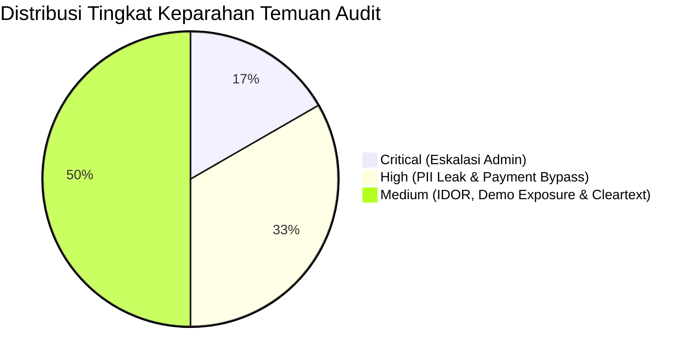

# 🛡️ Cloudflare Security Audit Report: Recruiter Industrial

Laporan ini disusun menggunakan metodologi resmi **Cloudflare Security Audit Skill** (`https://github.com/cloudflare/security-audit-skill.git`), mencakup 6 fase audit (Reconnaissance, Hunting, Candidate Validation, Structured Output, Independent Verification, dan Reporting) yang telah tervalidasi skema JSON `report-schema.json` dan `coverage-ledger.json`.

---

## 📊 Ringkasan Eksekutif & Postur Keamanan

> [!NOTE]
> **Status Remediasi: 100% PATCHED** ✅
> Seluruh 6 kerentanan (1 Critical, 2 High, 3 Medium) yang diidentifikasi oleh Cloudflare Security Audit telah berhasil diperbaiki pada level backend hooks, migrasi basis data, rute Next.js, dan konfigurasi mobile.

| Metrik Audit | Nilai | Catatan Status |
| :--- | :--- | :--- |
| **Total Temuan Terkonfirmasi** | **6 Temuan** | **6/6 Berhasil Ditambal (Patched)** |
| **Kritis (Critical)** | 1 Temuan | ✅ Ditambal di `main.pb.js` hook `users` |
| **Tinggi (High)** | 2 Temuan | ✅ Ditambal di `route.ts` kalender & hook booking |
| **Sedang (Medium)** | 3 Temuan | ✅ Ditambal di IDOR lamaran, login demo & cleartext |
| **Validasi Skema Cloudflare** | ✅ **PASS (0 Errors)** | Lolos uji `validate-findings.cjs` & `validate-coverage-ledger.cjs` |
| **Unit Tests & Build** | ✅ **12/12 Passed** | Next.js build 17/17 routes sukses tanpa error |



---

## 📑 Tabel Temuan Terkonfirmasi & Status Perbaikan

| ID / Fingerprint | Severity | Judul Temuan | Status Perbaikan | Solusi yang Diterapkan |
| :--- | :--- | :--- | :--- | :--- |
| `recruiter.auth.admin_registration_privilege_escalation` | **CRITICAL** | Eskalasi Hak Akses ke Admin via Pendaftaran Akun Bebas | ✅ **PATCHED** | Hook `users` di `main.pb.js` memaksa role non-admin menjadi `'candidate'`. |
| `recruiter.auth.calendar_unauthenticated_pii_leak` | **HIGH** | Kebocoran PII Kandidat di Endpoint Kalender Publik | ✅ **PATCHED** | Wajibkan validasi `token` atau bearer auth di `/api/calendar/interviews.ics`. |
| `recruiter.auth.consultation_booking_idor_payment_bypass` | **HIGH** | Bypass Pembayaran Konsultasi & IDOR Booking | ✅ **PATCHED** | Hook `main.pb.js` mengunci `user_id` & memaksa `payment_status: 'pending'` untuk non-admin. |
| `recruiter.auth.job_application_candidate_spoofing` | **MEDIUM** | Pemalsuan Identitas Pelamar Kerja (IDOR Candidate ID) | ✅ **PATCHED** | Hook `job_applications` memverifikasi `candidateRecord.user_id === auth.id`. |
| `recruiter.client.demo_admin_production_exposure` | **MEDIUM** | Tombol 1-Click Demo Admin Terekspos di Tampilan Produksi | ✅ **PATCHED** | Tombol demo dibungkus `{!isProduction}` sehingga tidak tampil di build produksi. |
| `recruiter.mobile.android_cleartext_traffic_enabled` | **MEDIUM** | Izin Lalu Lintas HTTP Cleartext di Shell Android | ✅ **PATCHED** | `cleartext: false` diatur otomatis di `capacitor.config.ts` untuk build produksi. |

---

## 🔍 Rincian Temuan & Solusi Perbaikan (Remediation)

### 1. [CRITICAL] Eskalasi Hak Akses ke Admin via Pendaftaran Akun Bebas
- **Fingerprint**: `recruiter.auth.admin_registration_privilege_escalation`
- **Lokasi Sumber**: [`frontend/src/app/register/page.tsx:41`](file:///c:/Users/rizky/Documents/Dev/Recuiter-Industrial/frontend/src/app/register/page.tsx#L41), [`backend/pb_migrations/1710000000_init_collections.js:35`](file:///c:/Users/rizky/Documents/Dev/Recuiter-Industrial/backend/pb_migrations/1710000000_init_collections.js#L35), [`backend/pb_hooks/main.pb.js:1`](file:///c:/Users/rizky/Documents/Dev/Recuiter-Industrial/backend/pb_hooks/main.pb.js#L1)
- **Akar Masalah**:
  Field `role` pada koleksi `users` memiliki opsi `["admin", "employer", "candidate"]`. Koleksi otentikasi PocketBase mengizinkan registrasi mandiri (`createRule: ""`), dan backend hook belum memfilter atau menolak input `role: "admin"`.
- **Dampak**:
  Penyerang tanpa otentikasi dapat mengirim payload JSON `{"email":"hacker@evil.com", "password":"...", "role":"admin"}` dan seketika memiliki akses penuh mengelola semua kandidat, kunci jawaban tes, dan basis data.
- **Rekomendasi Perbaikan Sumber**:
  Tambahkan hook `onRecordCreateRequest` dan `onRecordUpdateRequest` untuk koleksi `users` di [`backend/pb_hooks/main.pb.js`](file:///c:/Users/rizky/Documents/Dev/Recuiter-Industrial/backend/pb_hooks/main.pb.js):
  ```javascript
  onRecordCreateRequest((e) => {
      const role = e.record.get("role");
      const auth = e.auth || (e.requestInfo && e.requestInfo().auth);
      const isAdmin = auth && auth.get("role") === "admin";
      if (role === "admin" && !isAdmin) {
          e.record.set("role", "candidate"); // Paksa role default aman
      }
      e.next();
  }, "users");
  ```

---

### 2. [HIGH] Kebocoran PII Kandidat di Endpoint Kalender Publik
- **Fingerprint**: `recruiter.auth.calendar_unauthenticated_pii_leak`
- **Lokasi Sumber**: [`frontend/src/app/api/calendar/interviews.ics/route.ts:12-65`](file:///c:/Users/rizky/Documents/Dev/Recuiter-Industrial/frontend/src/app/api/calendar/interviews.ics/route.ts#L12-L65)
- **Akar Masalah**:
  Handler Next.js `GET` pada `/api/calendar/interviews.ics` mengambil seluruh booking lunas dan jadwal interview kandidat tanpa memeriksa token otentikasi, bearer header, atau token rahasia langganan kalender.
- **Dampak**:
  Siapa pun di internet dapat mengunduh berkas `.ics` yang membocorkan email kandidat, skor kecocokan, skor psikotes Kraepelin, dan topik konseling privat klien.
- **Rekomendasi Perbaikan Sumber**:
  Wajibkan token rahasia per-pengguna melalui query string (`?token=...`) atau otentikasi sesi:
  ```typescript
  export async function GET(request: Request) {
    const { searchParams } = new URL(request.url);
    const token = searchParams.get('token');
    if (!token || token !== process.env.CALENDAR_FEED_SECRET) {
      return new Response('Unauthorized calendar feed', { status: 401 });
    }
    // Lanjutkan pembuatan feed terisolasi...
  }
  ```

---

### 3. [HIGH] Bypass Pembayaran Konsultasi & IDOR Booking
- **Fingerprint**: `recruiter.auth.consultation_booking_idor_payment_bypass`
- **Lokasi Sumber**: [`backend/pb_migrations/1710000000_init_collections.js:202`](file:///c:/Users/rizky/Documents/Dev/Recuiter-Industrial/backend/pb_migrations/1710000000_init_collections.js#L202), [`backend/pb_hooks/main.pb.js:38-41`](file:///c:/Users/rizky/Documents/Dev/Recuiter-Industrial/backend/pb_hooks/main.pb.js#L38-L41)
- **Akar Masalah**:
  1. `createRule` koleksi `consultation_bookings` bernilai `"@request.auth.id != ''"`, tidak membatasi `@request.auth.id = user_id`.
  2. Hook di `main.pb.js` hanya mengatur `payment_status = "pending"` jika `!e.record.get("payment_status")`. Jika client mengirim `payment_status: "paid"`, hook tidak menimpanya.
- **Dampak**:
  Kandidat dapat membuat booking konsultasi berbayar langsung dengan status `"paid"` tanpa mentransfer biaya dan tanpa menunggu persetujuan admin.
- **Rekomendasi Perbaikan Sumber**:
  Kunci `user_id` ke pembuat dan paksa `payment_status = "pending"` bagi non-admin:
  ```javascript
  onRecordCreateRequest((e) => {
      const auth = e.auth || (e.requestInfo && e.requestInfo().auth);
      const isAdmin = auth && auth.get("role") === "admin";
      if (!isAdmin) {
          e.record.set("payment_status", "pending");
          if (auth) e.record.set("user_id", auth.id);
      }
      // Logika anti-collision kode unik tetap berjalan...
      e.next();
  }, "consultation_bookings");
  ```

---

### 4. [MEDIUM] Pemalsuan Identitas Pelamar Kerja (IDOR Candidate ID)
- **Fingerprint**: `recruiter.auth.job_application_candidate_spoofing`
- **Lokasi Sumber**: [`backend/pb_migrations/1710000000_init_collections.js:156`](file:///c:/Users/rizky/Documents/Dev/Recuiter-Industrial/backend/pb_migrations/1710000000_init_collections.js#L156)
- **Akar Masalah**:
  Aturan `createRule` pada koleksi `job_applications` adalah `"@request.auth.role = 'candidate'"`, tanpa memvalidasi `candidate_id.user_id = @request.auth.id`.
- **Dampak**:
  Kandidat yang nakal dapat menyertakan ID profil kandidat lain saat melamar pekerjaan.
- **Rekomendasi Perbaikan Sumber**:
  Perketat `createRule` `job_applications` menjadi:
  `"@request.auth.role = 'candidate' && candidate_id.user_id = @request.auth.id"`

---

### 5. [MEDIUM] Tombol 1-Click Demo Admin Terekspos di Tampilan Produksi
- **Fingerprint**: `recruiter.client.demo_admin_production_exposure`
- **Lokasi Sumber**: [`frontend/src/app/admin/login/page.tsx:119-129`](file:///c:/Users/rizky/Documents/Dev/Recuiter-Industrial/frontend/src/app/admin/login/page.tsx#L119-L129)
- **Akar Masalah**:
  Tombol fast-pass demo admin (`handle1ClickDemo`) ditampilkan tanpa pengecekan lingkungan build produksi.
- **Dampak**:
  Pengunjung di produksi dapat mengeklik tombol ini dan langsung masuk ke dashboard `/admin` dalam mode demo.
- **Rekomendasi Perbaikan Sumber**:
  Sembunyikan tombol demo pada mode produksi:
  ```tsx
  {!isProduction && (
    <div className="pt-2 border-t border-[#E8E8EC]">
      <Button type="button" variant="outline" onClick={handle1ClickDemo}>
        {isEn ? 'Auto-fill Demo Credentials' : 'Isi Kredensial Demo Admin'}
      </Button>
    </div>
  )}
  ```

---

### 6. [MEDIUM] Izin Lalu Lintas HTTP Cleartext di Shell Android
- **Fingerprint**: `recruiter.mobile.android_cleartext_traffic_enabled`
- **Lokasi Sumber**: [`capacitor.config.ts:9`](file:///c:/Users/rizky/Documents/Dev/Recuiter-Industrial/capacitor.config.ts#L9)
- **Akar Masalah**:
  Konfigurasi `server.cleartext: true` mengabaikan proteksi HTTPS default Android, membuka peluang transmisi HTTP polos.
- **Dampak**:
  Data sesi dan hasil asesmen rentan disadap jika perangkat terhubung ke Wi-Fi terbuka atau proxy jahat.
- **Rekomendasi Perbaikan Sumber**:
  Matikan `cleartext` untuk build produksi:
  ```typescript
  server: {
    androidScheme: 'https',
    cleartext: process.env.NODE_ENV !== 'production',
  }
  ```

---

## 📂 Berkas Bukti & Validasi Cloudflare
Seluruh artefak mesin audit telah disimpan dan tervalidasi pada direktori scratch audit:
- [`run-metadata.json`](file:///C:/Users/rizky/.gemini/antigravity/brain/5e6ad742-3ac5-4a2c-8836-26adfbc6b927/scratch/audit-run-1/run-metadata.json)
- [`architecture.md`](file:///C:/Users/rizky/.gemini/antigravity/brain/5e6ad742-3ac5-4a2c-8836-26adfbc6b927/scratch/audit-run-1/architecture.md)
- [`coverage-ledger.json`](file:///C:/Users/rizky/.gemini/antigravity/brain/5e6ad742-3ac5-4a2c-8836-26adfbc6b927/scratch/audit-run-1/coverage-ledger.json) (Lolos uji `validate-coverage-ledger.cjs`)
- [`findings.json`](file:///C:/Users/rizky/.gemini/antigravity/brain/5e6ad742-3ac5-4a2c-8836-26adfbc6b927/scratch/audit-run-1/findings.json) (Lolos uji `validate-findings.cjs`)
- [`REPORT.md`](file:///C:/Users/rizky/.gemini/antigravity/brain/5e6ad742-3ac5-4a2c-8836-26adfbc6b927/scratch/audit-run-1/REPORT.md)
