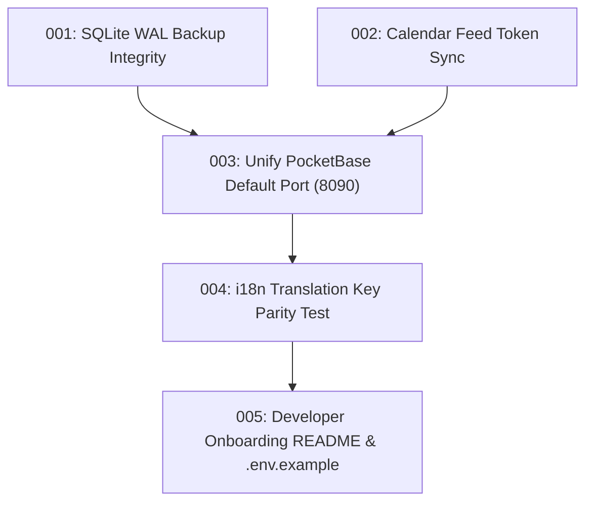

# Implementation Plans: Codebase Improvement

This directory contains prioritized, self-contained implementation plans generated by the `shadcn/improve` senior advisory workflow. Each plan is written for an independent executor model to implement, test, and verify without needing prior conversation context.

- **Audited Commit**: `1ea7139`
- **Audit Date**: 2026-11-18
- **Platform**: Recruiter Industrial (Next.js 16 + React 19 + PocketBase + Capacitor)

---

## Status Ledger

| # | Plan | Category | Priority | Effort | Risk | Dependencies | Status |
|---|------|----------|:--------:|:------:|:----:|:------------:|:------:|
| 001 | [001-backup-wal-integrity.md](001-backup-wal-integrity.md) | Correctness / Data Integrity | P1 | S | LOW | none | `DONE` |
| 002 | [002-calendar-token-sync.md](002-calendar-token-sync.md) | Bug / Correctness | P1 | S | LOW | none | `DONE` |
| 003 | [003-unify-pocketbase-default-ports.md](003-unify-pocketbase-default-ports.md) | Tech Debt / Architecture | P2 | S | LOW | none | `DONE` |
| 004 | [004-i18n-dictionary-parity-test.md](004-i18n-dictionary-parity-test.md) | Test Coverage | P2 | S | LOW | none | `DONE` |
| 005 | [005-developer-onboarding-readme-env.md](005-developer-onboarding-readme-env.md) | Docs / DX | P3 | S | LOW | none | `DONE` |

---

## Recommended Execution Order

1. **Plan 001 & 002 (P1 Critical Correctness)**:
   - Fixes live database backup truncation in SQLite WAL mode.
   - Synchronizes calendar feed subscription tokens and eliminates 401/404 errors for administrators.
2. **Plan 003 (P2 Architectural Port Symmetry)**:
   - Aligns default PocketBase port to 8090 across server routes and client SDK.
3. **Plan 004 (P2 Quality Characterization)**:
   - Establishes a regression safety net ensuring Indonesian and English translations stay 100% in sync.
4. **Plan 005 (P3 Documentation)**:
   - Sets up standard developer setup guide and environment variable contract.

---

## Grounded Direction Proposals (Future Roadmap)

These feature directions were identified from code evidence and architectural patterns for future design/spike plans:

1. **Direction A — Headless Server-Side PDF Psychogram Generator**
   - *Evidence*: `frontend/src/app/candidate/results/page.tsx:73` currently relies on client-side `window.print()`. A server-side PDF generator (via PDFKit) will enable one-click official HIMPSI-standard dossier downloads and automated emailing to factory HR departments.
   - *Effort*: M (2-3 days).
2. **Direction B — Automated WhatsApp Business Status Dispatcher**
   - *Evidence*: `CandidateNotificationModal` currently relies on clipboard copy-pasting for WhatsApp links. Integrating an automated webhook consumer for WhatsApp Business Cloud API will automate candidate interview invitations.
   - *Effort*: M (2 days).
3. **Direction C — Bulk Applicant Multi-Select in Employer Kanban**
   - *Evidence*: `frontend/src/app/employer/page.tsx` processes candidate status changes card-by-card. Adding multi-select checkboxes for batch status progression ("Move 20 applicants to Kraepelin Test") will significantly boost HR productivity during plant hiring surges.
   - *Effort*: M (1-2 days).

---

## Considered and Rejected Findings

To avoid re-auditing settled trade-offs in future runs:

- **SSO Helpdesk External IP Connection (`https://43.156.236.102/helpdesk/handoff`)**:
  - *Considered*: Flagged as hardcoded external IP.
  - *Verdict*: **Rejected / By-Design**. Settled architecture tradeoff documented in `GLOSSARY.md:16` for cross-VPS helpdesk ticket handoff without local auth duplication.
- **`unsafe-eval` or Dynamic Imports in Remotion & Radars**:
  - *Considered*: Dynamically importing `@remotion/player` and SVG radars.
  - *Verdict*: **Rejected / By-Design**. Essential for client-side rendering optimization and Next.js initial bundle size reduction.
- **Client-Side Anti-Cheat Keyboard Latency Monitoring**:
  - *Considered*: Rapid keystroke detection (<130ms) flagged as client-side heuristic.
  - *Verdict*: **Rejected / By-Design**. Validated by automated tests in `p0-p2-enhancements.test.mjs` as a complementary UX guard alongside server-side scoring validation.
